# sindex architecture

`sindex` is a Windows 11 service that full-text indexes local files and serves a local search page. Every design
decision is judged against one requirement: **minimal CPU, RAM and SSD writes, even if indexing gets slower.**
`README.md` explains what it does and how to run it; `AGENTS.md` explains how to change it. This file explains how
the pieces fit together.

The diagrams are [Mermaid](https://mermaid.js.org/) and render on GitHub and in VS Code's Markdown preview.

## Contents

1. [Process view](#1-process-view)
2. [Module layers](#2-module-layers)
3. [Class diagram](#3-class-diagram)
4. [Database schema](#4-database-schema)
5. [Indexing pipeline](#5-indexing-pipeline-sequence)
6. [Change detection](#6-change-detection)
7. [Search flow](#7-search-flow-sequence)
8. [Control plane (web UI to indexer)](#8-control-plane)
9. [Indexer lifecycle](#9-indexer-lifecycle-state-diagram)
10. [Resource control](#10-resource-control)
11. [Design rules that the diagrams rely on](#11-design-rules-that-the-diagrams-rely-on)
12. [Why not FastAPI and asyncio](#12-why-not-fastapi-and-asyncio)
13. [Security model](#13-security-model)

---

## 1. Process view

At run time sindex is a small tree of OS processes. Only the **indexer** writes the database; only the **service**
talks to the network; only the **extraction workers** parse untrusted file content.

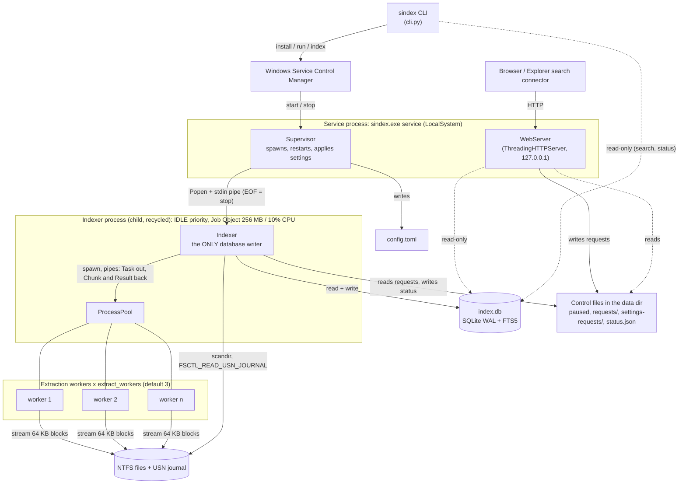

Why this shape:

| Decision | Reason |
|---|---|
| Parsing is in a child process, not the service | Only a new process returns memory to Windows. The supervisor recycles the indexer every `recycle_after_files` files or when it grows past `recycle_rss_mb`. |
| Parsing is in worker processes, not the indexer | One Python process can use one core at most, and PDF parsing is where the time goes. The indexer stays the single writer, so workers send text back over pipes. |
| `stdin` pipe from supervisor to indexer | EOF on stdin means "finish the current file and exit". A killed service still ends the indexer, and the indexer ends the workers. |
| Web UI controls the indexer through files | The web layer needs no write access to the database and no IPC protocol. |

---

## 2. Module layers

Arrows mean "may import". The layering is enforced by convention and by review (see `AGENTS.md` section 1).

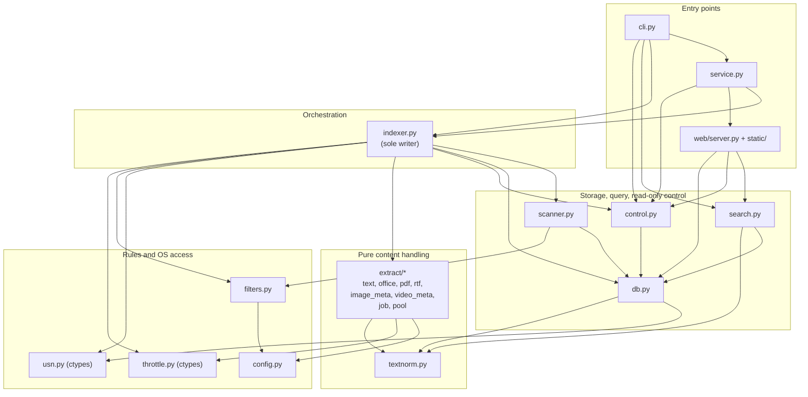

Hard boundaries:

* `extract/*` and `textnorm.py` never import `db`, `search`, `scanner`, `indexer`, `service`, `web`, `control` or
  `cli`. `extract` may use `config` and `throttle`.
* SQL lives only in `db.py`, `search.py`, `control.py`, `scanner.py` and `indexer.py`. The web layer has none.
* `ctypes` and pywin32 code lives only in `throttle.py`, `usn.py`, `service.py` and the service commands of `cli.py`.
* No module-level singletons. `Config`, connections and `Throttle` are passed as arguments and constructed at entry
  points (`cli.py`, `service.py`, `indexer.main`).

### Module responsibilities

| Module | Responsibility |
|---|---|
| `config.py` | `Config` dataclass, TOML load / validate / render / apply, `Spec`, logging setup. |
| `filters.py` | `PathFilter`: roots, exclusion globs, hidden files, `file_kind()`. |
| `scanner.py` | One-directory-at-a-time walk that reconciles a subtree with the `files` table and fills `queue`. |
| `usn.py` | NTFS change journal (`Journal`, `Change`, `JournalError`), drive discovery. |
| `throttle.py` | `Throttle` (duty cycle, pause rules, read rate), `ThrottledReader`, Job Object and priority setup. |
| `indexer.py` | The indexer process: queue loop, write batching, volumes, requests, maintenance, status file. |
| `extract/__init__.py` | `kind_of`, `max_bytes`, `Context`, `MediaFields`, dispatch `extract()`. |
| `extract/job.py` | `Task`, `Chunk`, `Result` messages and `run_job()`, which turns a file into normalized chunks. |
| `extract/pool.py` | `InlineRunner` and `ProcessPool`, behind one interface. |
| `textnorm.py` | Case/accent folding, CJK bigrams, Greek/Hebrew/Arabic marks, chunking. |
| `db.py` | Schema, `connect()`, queue and media helpers, location check. |
| `search.py` | Query language, `build_match()`, `search()`, snippets. |
| `control.py` | Control-file writers (pause, requests, settings), status and statistics readers, log reader. |
| `service.py` | `Supervisor`, `SindexService` (pywin32), install helpers, `run_core`. |
| `web/server.py` | HTTP routes, token and Host checks, `SearchRegistry` for cancelling superseded searches. |
| `cli.py` | Subcommands, shortcuts, context menu, App Paths, Explorer search connector, elevation. |

---

## 3. Class diagram

The main types and who owns whom. Dataclasses are marked `<<dataclass>>`.

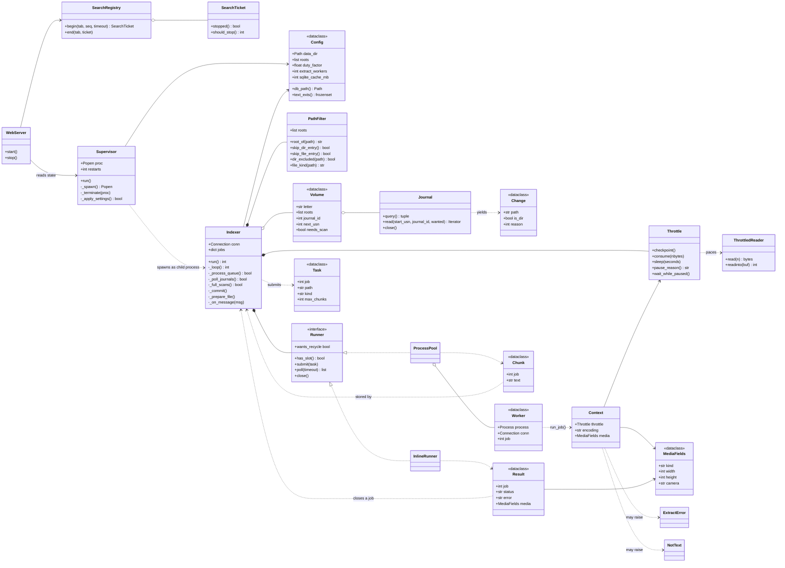

---

## 4. Database schema

One SQLite file (`index.db`) in WAL mode. `chunks` is an FTS5 table; a file's chunks occupy a reserved rowid range, so
no separate mapping table is needed: `file_id = chunks.rowid >> 16`.

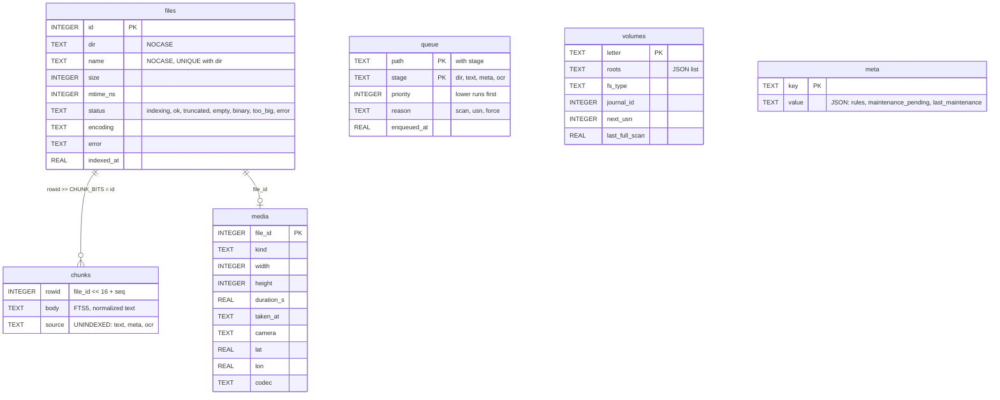

`queue`, `volumes` and `meta` carry the indexer's persistent state, which is why a recycle or crash loses nothing.
`ocr_*` columns and the `ocr` stage are reserved for a later phase.

**Queue priorities** (lower number first): forced reindex 1, directory scan 5, easy text 10, photo/video metadata 12,
hard formats (PDF, Office, RTF) 15. Cheap files become searchable first.

---

## 5. Indexing pipeline (sequence)

How one queued file becomes searchable text. The indexer never parses; it prepares the file, hands a `Task` to a
runner, and stores the `Chunk` messages that come back inside one long transaction.

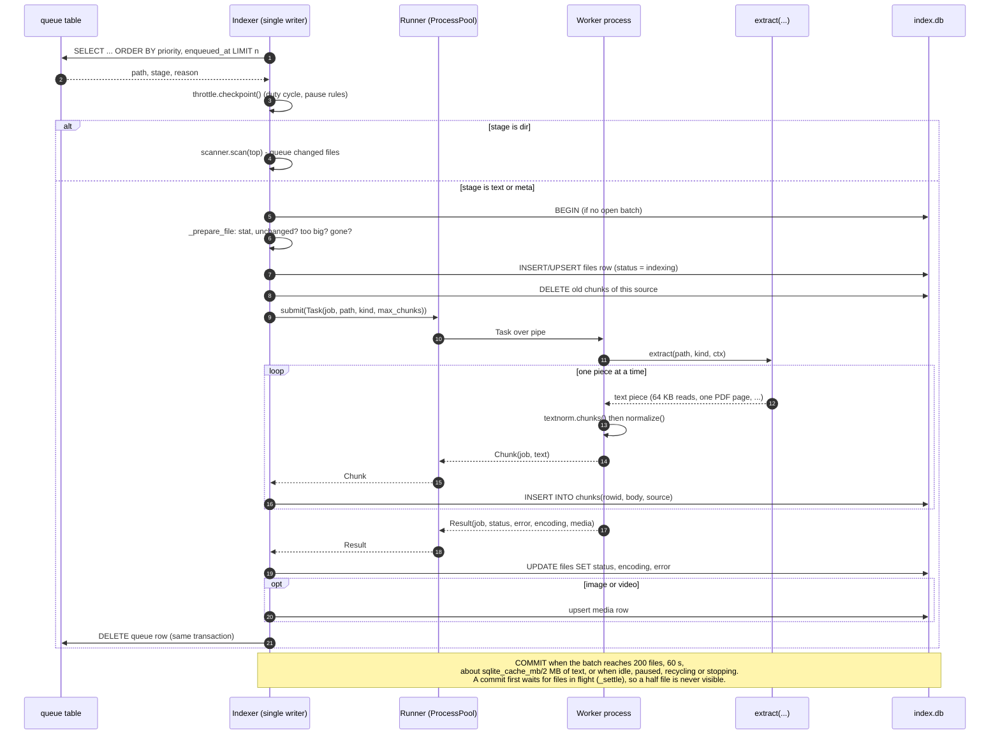

Failure handling inside this flow:

* `run_job()` turns every failure into a `Result` with an explicit status: `binary` (`NotText`), `error`
  (`ExtractError`, `OSError`, `MemoryError`, or a logged parser bug), `empty`, `truncated`, `too_big`. An unreadable
  document is never stored as "indexed, empty".
* If a worker dies, only its file is recorded as `error` and the worker is replaced.
* On stop, `_abandon_jobs()` deletes the half-indexed `files` rows. Their queue rows are still present, so they are
  redone. There is deliberately no `SAVEPOINT` per file: FTS5 would write a new segment on every savepoint.

### Extractors

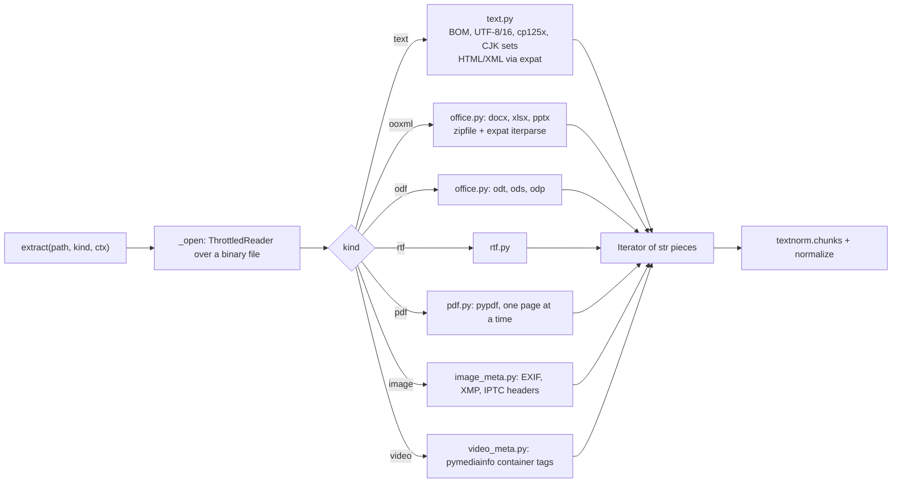

`kind_of(ext, cfg)` decides the kind from the extension and the configuration. Files without a configured extension
are not indexed, and media kinds are only produced when `index_media_metadata` is on.

---

## 6. Change detection

Two mechanisms feed the same `queue` table. Everything downstream (the pipeline in section 5) is identical.

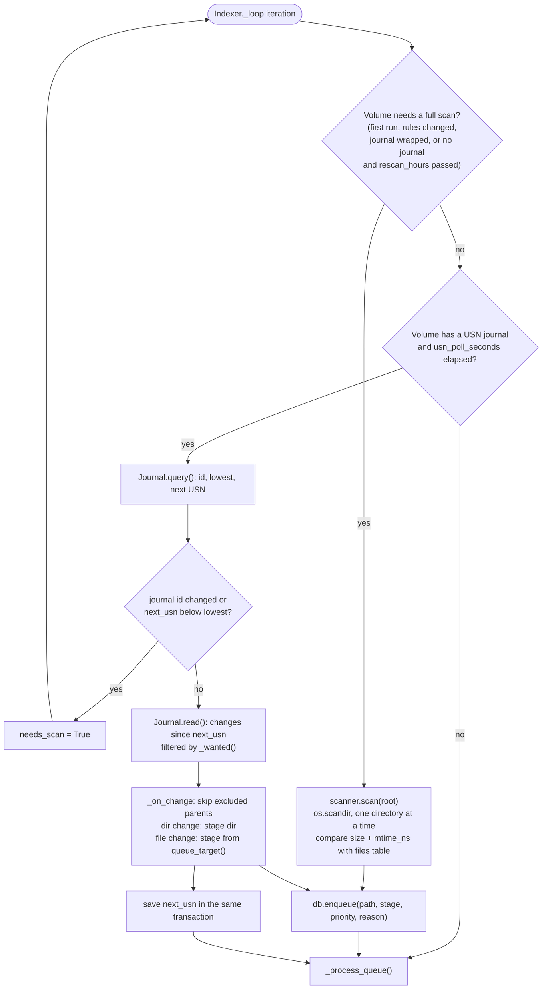

* The journal position is recorded **before** a full scan starts, so a change made during the scan is not missed.
* Position and queued changes are saved in one transaction.
* Reading the journal needs administrator rights. Without them, or on a volume without a journal, the indexer falls
  back to a periodic rescan (`rescan_hours`).
* A deleted or newly excluded file is queued too; `_prepare_file` then finds it missing or filtered and removes its
  rows.
* When indexing rules change (`exclude_globs`, extensions, hidden files, size limits, media switch), the new rules
  are stored in `meta` only after the rescan they cause has finished, so an interrupted rescan restarts.

---

## 7. Search flow (sequence)

Search is read-only and runs on web server threads. The query always passes through `search.build_match()` and the
index text through `textnorm.normalize()`, so both sides fold case, accents and CJK bigrams identically.

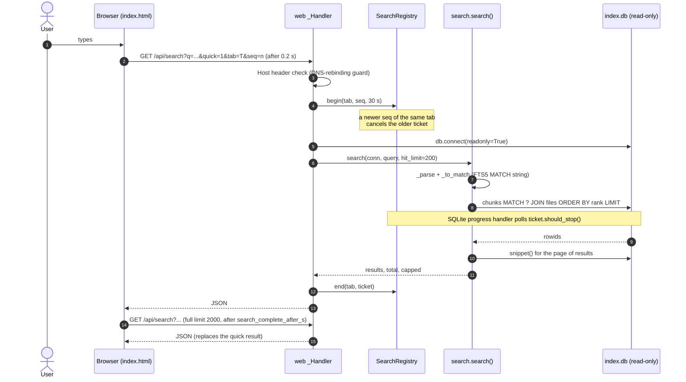

Search features, all in `search.py`:

* Words, phrases, prefixes, OR groups and negation, built into one FTS5 `MATCH` string.
* Optional `names` mode that also scans folder and file names (a table scan, so opt-in).
* Filters: path, extensions, modified date range, and the media filters (camera, GPS, size, duration, date taken).
  With media filters and no words it browses by filter alone, newest first.
* At most two searches run at once; a search over 30 s is stopped.

The same query language is exposed three more ways: `sindex search` (CLI), `/api/search.rss` (Explorer search
connector, described by `/opensearch.xml`), and the `sindex <words>` shortcut through the registry's App Paths entry.

### HTTP surface

| Route | Method | Auth | Purpose |
|---|---|---|---|
| `/`, `/settings`, `/log` and `/style.css` | GET | none | Static pages, with `{{TOKEN}}` and `{{VERSION}}` substituted |
| `/api/search`, `/api/search.rss`, `/opensearch.xml` | GET | none | Search |
| `/api/export.csv` | GET | none | All files of the page's search as CSV (same parameters as `/api/search`) |
| `/api/status`, `/api/settings`, `/api/health` | GET | none | State, current settings, problem files |
| `/api/browse`, `/api/log` | GET | token | Folder picker, log viewer (they reveal local paths) |
| `/api/pause`, `/api/resume`, `/api/reindex`, `/api/retry`, `/api/rebuild`, `/api/maintenance`, `/api/settings`, `/api/open` | POST | token | Control actions |

All requests must carry a `Host` of `127.0.0.1`, `localhost` or `[::1]` with the configured port. POSTs are
serialized by a lock and verified with a constant-time token comparison.

---

## 8. Control plane

The web UI and CLI never call into the indexer. They drop small files into the data directory and the indexer (or the
supervisor, for settings) picks them up.

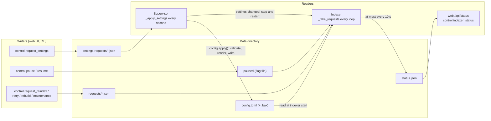

| Request | Handled by | Effect |
|---|---|---|
| `paused` file | `Throttle` via `Indexer._user_pause` | Indexer commits and idles until the file is removed. Worker processes check the same flag. |
| `{"path": ...}` | `Indexer._handle_request` | Enqueue a forced `dir` or file entry. |
| `{"status": ...}` | `Indexer._retry_status` | Requeue every file that ended with that status. |
| `{"rebuild": true}` | `Indexer._handle_request` | Enqueue a forced scan of every root. |
| `{"maintenance": ...}` | `Indexer._run_maintenance` | `optimize` (FTS merge) or `compact` (VACUUM), run only when the queue is empty. |
| settings request | `Supervisor._apply_settings` | Validated by the web layer, written to `config.toml` by the service, then the indexer restarts. A rejected change leaves the file as it was and is shown in the status. |

The page validates before it writes a request, and the supervisor validates again, because `config.toml` may have been
edited by hand in between.

---

## 9. Indexer lifecycle (state diagram)

States follow `status.json` (`state`) plus the process-level outcomes the supervisor reacts to.

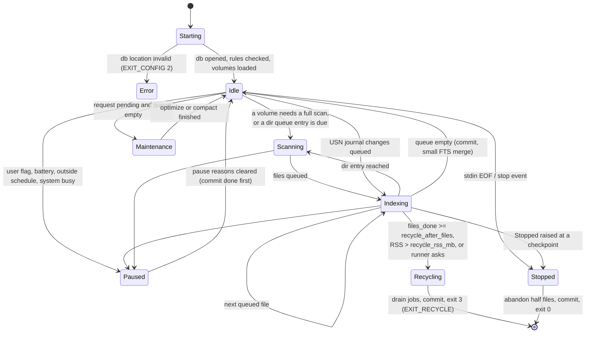

The supervisor's view of the same process:

```mermaid
stateDiagram-v2
    [*] --> Spawning
    Spawning --> Watching: Popen ok
    Watching --> Spawning: exit 3 (recycle), restart at once
    Watching --> Restarting: settings applied, terminate and restart
    Restarting --> Spawning
    Watching --> Backoff: any other exit code
    Backoff --> Spawning: wait 30 s, doubling to 900 s;<br/>cut short by a settings change
    Backoff --> [*]: service stop
    Watching --> [*]: service stop, close stdin, wait 30 s, then taskkill /T
```

---

## 10. Resource control

Because the goal is a tiny footprint, throttling is part of the architecture rather than a tuning knob.

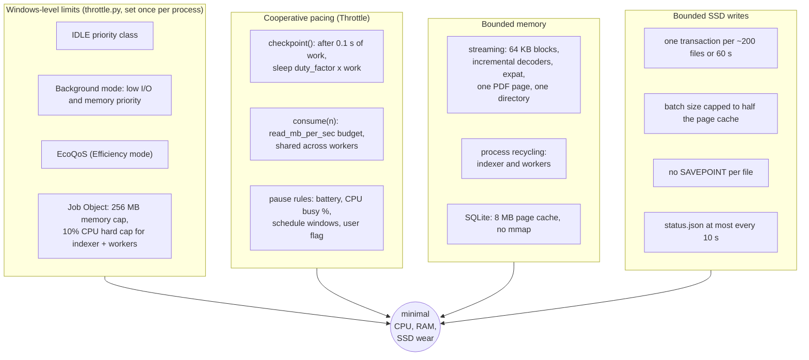

Every extractor reads through `ThrottledReader`, which calls `Throttle.consume()` on each read, so pacing needs no
cooperation from the parser beyond using the reader it is given. `ProcessPool` divides `read_mb_per_sec` by the worker
count so the limit holds for the whole indexer.

---

## 11. Design rules that the diagrams rely on

1. **One writer.** Only `indexer.py` (with `scanner.py` and the `db.py` helpers it drives) writes `index.db`. The web
   layer and CLI open it with `db.connect(..., readonly=True)`.
2. **The queue is the source of truth for pending work.** Everything the indexer wants to do later is a row in
   `queue`, so recycling, crashes and restarts are safe.
3. **Never half a file.** A file's rows are visible only after its `Result` arrives and its batch commits. Commits wait
   for files in flight.
4. **Explicit failure over default data.** Extraction failures become a stored status (`error`, `binary`, `too_big`,
   `truncated`, `empty`), never an empty "indexed" file.
5. **Typed failures at boundaries.** Third-party exceptions (`pypdf`, `expat`, `zipfile`) become `ExtractError` or
   `NotText` in `extract/*`; the journal raises `JournalError`; throttling raises `Stopped`.
6. **Text goes through `textnorm`.** Stored text uses `normalize()`; queries use `search.build_match()`. Bypassing
   either silently breaks matching.
7. **Windows code is isolated.** `ctypes` and pywin32 stay in `throttle.py`, `usn.py`, `service.py` and the service
   commands of `cli.py`; there are no cross-platform shims.
8. **Dependencies are explicit.** `Config`, connections and throttles are passed as arguments; long-lived objects are
   built only at entry points.

### Packaging

`packaging/build.py` builds a PyInstaller **folder** (not a one-file executable, because a service must answer the
service control manager within seconds). `sindex.exe` is one binary with several roles, selected by subcommand:

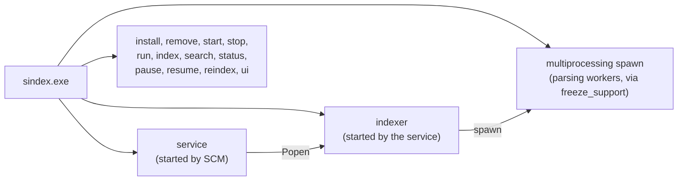

`sindex install` copies the program folder to `%ProgramFiles%\sindex`, registers the service (delayed automatic start,
LocalSystem), and creates the Desktop and Start menu shortcuts, the folder context-menu verb, the App Paths entry and
the Explorer search connector. `sindex remove` undoes all of them.

---

## 12. Why not FastAPI and asyncio

The web UI is `http.server.ThreadingHTTPServer` with a handler class, and the whole program uses threads and
processes. There is no `asyncio` and no web framework. This is deliberate. The reasons are below; they are
arguments from the design, not benchmark results.

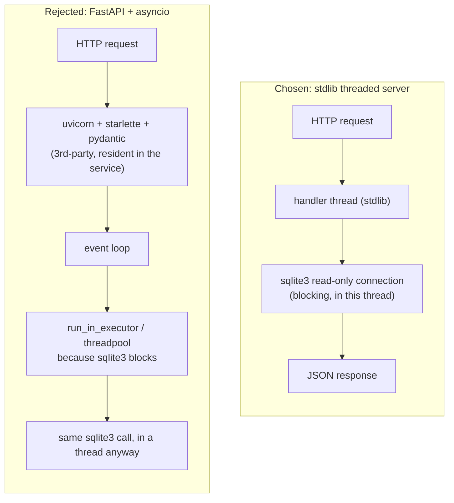

### 1. Footprint is the primary requirement

The project is judged on resident memory and CPU (`AGENTS.md`: "Do not add a third-party dependency for something
the standard library does; this project is judged on resident footprint"). The service process stays resident all
day. FastAPI would bring `starlette`, `pydantic` (with a compiled core) and an ASGI server such as `uvicorn`, and all
of them would be imported at service start and kept in memory. `http.server` is already in the standard library and
costs nothing extra. The same reasoning is behind `pypdf[cryptodome]` instead of the heavier `crypto` extra, noted in
`pyproject.toml`.

### 2. The work is blocking and local, so async buys nothing

`asyncio` helps when one process waits on many slow network connections. Here:

* The only client is a browser on `127.0.0.1`, with a handful of concurrent requests at most.
* The expensive part of a request is a SQLite query, and the `sqlite3` module is blocking. An async handler would
  have to push every query into a thread pool, so the code would run in a thread anyway, with an event loop added
  on top.
* SQLite can already run one query per connection per thread in parallel. The server opens one read-only
  connection per request and limits searches to two at a time (`SEARCH_SLOTS`), which is the real concurrency limit
  and is independent of the I/O model.

### 3. Cancelling a search needs a thread-level hook, not a task

A newer search in the same browser tab must cancel the older one, and a search over 30 s must stop
(`SearchRegistry`, `SearchTicket`). This works by a SQLite progress handler that polls `ticket.should_stop()` inside
the running query, and it stops the query at the SQLite level. `asyncio` task cancellation cannot interrupt a
blocking C call: it would cancel the `await`, leave the query running in the executor thread, and still hold a
connection and a slot. The thread-plus-progress-handler design is both simpler and correct.

### 4. Parallelism comes from processes, not from an event loop

The heavy work is parsing, mainly PDFs, and it is CPU-bound. Neither threads nor `asyncio` run Python code on several
cores at once. The architecture uses separate processes for that: the indexer child, and the `ProcessPool` of
extraction workers (section 1). The pool is already an explicit, bounded message-passing design: `has_slot()`,
`submit()`, `poll()` over `multiprocessing` pipes, where a worker blocks on `send` until the indexer reads. Replacing
it with coroutines would add nothing, and it would remove the process boundary that returns memory to Windows when a
process is recycled.

### 5. Throttling is synchronous by design

`Throttle.checkpoint()` and `consume()` implement the duty cycle, the read-rate limit and the pause rules by
**sleeping the calling thread** (`stop.wait()`), and they raise `Stopped` to unwind the stack. Every extractor is a
plain generator that calls into a `ThrottledReader`. Making that cooperative with `async`/`await` would turn every
extractor, the scanner and `textnorm` into coroutines, or would need a sync-to-async bridge at each read. Sleeping is
what we want here: a sleeping thread uses no CPU. In addition, `extract/*` and `textnorm.py` are meant to be pure and
framework-free (section 2); `async` would spread through them.

### 6. Windows service and Job Object constraints

The service host (`pywin32`'s `ServiceFramework`) is a blocking callback model: `SvcDoRun` runs until the service
ends, and `SvcStop` signals it with a `threading.Event`. The `Supervisor`, `Popen` handling, `stdin` EOF shutdown and the `multiprocessing` `spawn` workers
all use blocking calls and threads. A running event loop would be one more thing to start, stop and tear down inside
the 30 s service stop window, and it would make the interplay with `ctypes` calls (USN journal, Job Object) harder to
reason about, because those calls block the loop too.

### 7. What the API actually needs

The API is a few JSON routes and three static pages (section 7). FastAPI's strengths are not used here:

| FastAPI feature | Why it is not needed |
|---|---|
| Pydantic request validation | Bodies are small flat dicts. Settings are validated by `config.validate_changes()`, which also serves the CLI and the supervisor, so a second schema would duplicate it. |
| OpenAPI and docs UI | The only client is the project's own static pages and the Explorer search connector. |
| Dependency injection | `Config` is passed explicitly (the project rule is no singletons), and the server object already holds it. |
| Async I/O, WebSockets | The page polls `/api/status` and the log; nothing streams. |
| Middleware, routing | A dozen routes are an `if` chain in `do_GET` / `_post`. Host-header and token checks are a few lines each, and there is one place to review them. |

### Trade-offs accepted

* **Thread per connection.** `ThreadingHTTPServer` creates a thread per request. That is acceptable for a
  localhost UI with one user. Searches are capped by `SEARCH_SLOTS`; every other route is quick.
* **Hand-written routing and header handling.** More code than a framework would need, but it is small, has no
  parsing surface beyond the standard library, and `MAX_BODY` bounds request size.
* **No HTTPS or HTTP/2.** Not needed for a loopback-only server; the Host check and the token cover the realistic
  threat (other web pages reaching `localhost`).

### When to revisit

Reconsider only if requirements change in a way that makes async I/O the bottleneck: remote access by many users,
streaming results over WebSockets, or a long-lived push feed. None of these is planned, and the process and
threading model above would still be needed for parsing and database writes.

---

## 13. Security model

The index contains the text of the files of every account on the PC, so reading it is the asset to protect. The
service runs as LocalSystem and so does the indexer: `index.db` belongs to SYSTEM, and the app has no notion of a
"user who created the index". Protection covers the **HTTP connection only**, by design, to keep install and
operation simple.

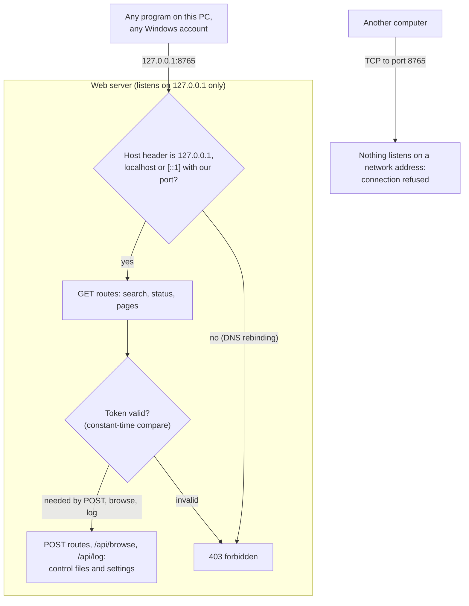

| Threat | Stopped by |
|---|---|
| Another computer reads the index | The server listens on `127.0.0.1`. `config.check_web_host` accepts only an IPv4 loopback address: `config.load` raises `ConfigError` (the service does not start) and `WebServer.start` refuses to start on anything else or on a socket bound elsewhere. |
| A web page in a browser reaches the server under a foreign name (DNS rebinding) | The `Host` header must be `127.0.0.1`, `localhost` or `[::1]` with the configured port. |
| A web page or program pauses the indexer, changes settings, browses folders or reads logs | The token (`X-Sindex-Token`, compared with `hmac.compare_digest`) on every POST, `/api/browse` and `/api/log`. Settings are validated before they are written. |
| Oversized or malformed requests | `MAX_BODY` bounds the body; bodies must be a JSON object; at most two searches run at once and a search stops after 30 s. |

**Not protected, on purpose:**

* **Other accounts on the same PC.** Loopback is open to every account (and the Windows firewall does not filter it),
  so another user, or malware running under one, can open `http://127.0.0.1:8765/` and search. The search and status
  routes need no token.
* **The files themselves.** `index.db`, `config.toml` (with the token) and the logs sit in `%ProgramData%\sindex`,
  which inherits read access for ordinary users from `%ProgramData%`. A local administrator can always read them.
* **Results are not filtered by the caller's file permissions.** The indexer reads every account's files as SYSTEM,
  so anyone who can search can see text of files they could not open themselves.

**Options considered and not implemented**, in case the requirement changes: a Windows Firewall block rule for the
port added at install; an allow-list of Windows accounts, checked by looking up the owner of each loopback connection
(TCP table, then process token); restricting the data folder to SYSTEM and Administrators; a token on the read routes;
a named pipe with an ACL (browsers cannot talk to one); a per-user index. Each adds install steps, moving parts or
breaks a way of using the search (CLI `search` reads the database directly, the Explorer search connector and the
right-click verb use plain URLs).
